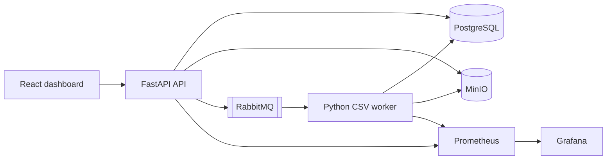

# CloudTask

CloudTask is a full-stack application that accepts a CSV upload, creates a durable asynchronous task, profiles the CSV in a separate worker, and returns a JSON report. It is designed to demonstrate practical backend boundaries: HTTP requests stay short, PostgreSQL owns lifecycle state, RabbitMQ handles delivery, and MinIO stores files outside the database.

## What is included

- FastAPI API with OpenAPI at `http://localhost:8000/docs`.
- React dashboard at `http://localhost:3000` for uploads, status tracking, and JSON report downloads.
- PostgreSQL persistence and Alembic migrations.
- RabbitMQ durable queue, delayed retry queue, and dead-letter queue.
- MinIO input and output object storage.
- Separate Python worker that creates CSV profile reports.
- Prometheus metrics and a provisioned Grafana dashboard.
- Docker Compose for the local system and Kubernetes manifests for app deployment.

## Architecture



The worker writes a deterministic key, `reports/<task-id>.json`. A redelivered message for a completed task is acknowledged without creating a second result. Temporary worker failures return a task to `PENDING`, are delayed through the retry queue, and eventually land in the dead-letter queue after the configured attempt limit. Permanent CSV content errors set the task to `FAILED` immediately.

## Repository layout

```text
backend/
  app/                 FastAPI API, domain model, adapters, and worker
  alembic/             PostgreSQL migrations
  tests/               unit and Testcontainers integration tests
  Dockerfile
frontend/
  src/                 React JavaScript/JSX application and component tests
  Dockerfile
infra/
  monitoring/          Prometheus config and Grafana provisioning
  kubernetes/base/     app deployments, services, ingress, and secret template
compose.yaml           local application, initialization, data, and monitoring services
docs/                  specification, architecture, API, and roadmap
```

## Prerequisites

- Docker Desktop or Docker Engine with Docker Compose v2.
- For local non-Docker development: Python 3.12 and Node.js 22.
- A free set of local ports: `3000`, `3001`, `5432`, `5672`, `8000`, `9000`, `9001`, `9090`, and `15672`.

## Configure and start locally

From the repository root in PowerShell:

```powershell
Copy-Item .env.example .env
notepad .env
docker compose up --build -d
docker compose ps
```

Replace every `CHANGE_ME` value in `.env` with locally chosen credentials before the Compose command. Do not commit `.env`. Use URL-safe PostgreSQL passwords because the Compose connection URLs include them directly.

Existing installations that already have `CLOUDTASK_POSTGRES_USER`, `CLOUDTASK_POSTGRES_PASSWORD`, and `CLOUDTASK_POSTGRES_DB` do not need to add dedicated-role variables just to run Compose. When all four dedicated-role variables are absent, Compose uses the existing PostgreSQL user and password for both the migration and application connections. This compatibility mode preserves the existing volume, role ownership, and credentials.

### PostgreSQL first initialization and credentials

On a fresh `postgres-data` volume, PostgreSQL creates the following identities exactly once:

- `CLOUDTASK_POSTGRES_USER` is the bootstrap database administrator. CloudTask does not use it after initialization.
- `CLOUDTASK_POSTGRES_MIGRATION_USER` owns the `public` schema and the Alembic migration objects. Only the `migrate` service uses it.
- `CLOUDTASK_POSTGRES_APPLICATION_USER` is used by the API and worker. It has `SELECT`, `INSERT`, `UPDATE`, and `DELETE` rights on migration-created tables, plus schema usage; it has no schema-creation or database-administration privilege.

The PostgreSQL image reads `POSTGRES_USER`, `POSTGRES_PASSWORD`, and `POSTGRES_DB` only while the data directory is empty. Changing these or any CloudTask PostgreSQL credentials in `.env` later does not alter an existing volume, role password, schema owner, or table owner. Configure `.env` before the first `docker compose up`.

For every fresh installation, start from `.env.example` and keep the four dedicated-role values. The initialization script then creates the migration owner and least-privileged application role. Do not add new dedicated-role values to an existing legacy volume unless you are intentionally adopting those roles with the procedure below; adding environment variables alone cannot create database roles in an initialized volume.

### Optional non-destructive dedicated-role adoption for an existing PostgreSQL volume

Use this only when an existing volume needs separate migration and application roles, or when a previous application role owns `alembic_version` or `tasks`. Keep `CLOUDTASK_POSTGRES_USER` and `CLOUDTASK_POSTGRES_PASSWORD` set to the original bootstrap administrator credentials long enough to repair the roles. Set the new migration and application values in `.env`, then start only PostgreSQL:

```powershell
docker compose up -d postgres
docker compose exec -it postgres psql -U ORIGINAL_BOOTSTRAP_ADMIN -d cloudtask
```

At the `psql` prompt, replace each `REPLACE_*` value with the matching value from `.env`, then run this SQL. It creates or updates only the two CloudTask service roles, transfers ownership of the actual Alembic and task tables, and grants the runtime role only the permissions used by this application. It does not delete a volume, database, table, or task data.

```sql
DO $$
BEGIN
  IF NOT EXISTS (SELECT 1 FROM pg_roles WHERE rolname = 'cloudtask_migrate') THEN
    CREATE ROLE cloudtask_migrate LOGIN PASSWORD 'REPLACE_MIGRATION_PASSWORD' NOSUPERUSER NOCREATEDB NOCREATEROLE NOINHERIT;
  ELSE
    ALTER ROLE cloudtask_migrate LOGIN PASSWORD 'REPLACE_MIGRATION_PASSWORD' NOSUPERUSER NOCREATEDB NOCREATEROLE NOINHERIT;
  END IF;
  IF NOT EXISTS (SELECT 1 FROM pg_roles WHERE rolname = 'cloudtask_app') THEN
    CREATE ROLE cloudtask_app LOGIN PASSWORD 'REPLACE_APPLICATION_PASSWORD' NOSUPERUSER NOCREATEDB NOCREATEROLE NOINHERIT;
  ELSE
    ALTER ROLE cloudtask_app LOGIN PASSWORD 'REPLACE_APPLICATION_PASSWORD' NOSUPERUSER NOCREATEDB NOCREATEROLE NOINHERIT;
  END IF;
END $$;

REVOKE CONNECT ON DATABASE cloudtask FROM PUBLIC;
GRANT CONNECT ON DATABASE cloudtask TO cloudtask_migrate, cloudtask_app;
ALTER SCHEMA public OWNER TO cloudtask_migrate;
REVOKE ALL ON SCHEMA public FROM PUBLIC;
GRANT USAGE, CREATE ON SCHEMA public TO cloudtask_migrate;
GRANT USAGE ON SCHEMA public TO cloudtask_app;
DO $$
BEGIN
  IF to_regclass('public.alembic_version') IS NOT NULL THEN
    ALTER TABLE public.alembic_version OWNER TO cloudtask_migrate;
  END IF;
  IF to_regclass('public.tasks') IS NOT NULL THEN
    ALTER TABLE public.tasks OWNER TO cloudtask_migrate;
    GRANT SELECT, INSERT, UPDATE, DELETE ON TABLE public.tasks TO cloudtask_app;
  END IF;
END $$;
ALTER DEFAULT PRIVILEGES FOR ROLE cloudtask_migrate IN SCHEMA public
  GRANT SELECT, INSERT, UPDATE, DELETE ON TABLES TO cloudtask_app;
ALTER DEFAULT PRIVILEGES FOR ROLE cloudtask_migrate IN SCHEMA public
  GRANT USAGE, SELECT ON SEQUENCES TO cloudtask_app;
```

Use the actual database name and role names from `.env` if they differ from the defaults above. Exit `psql` with `\q`, then run `docker compose up -d migrate` and inspect `docker compose logs migrate`. If the original bootstrap administrator password is unavailable, obtain it from the owner of the existing database or a backup; a new `.env` value cannot replace it automatically.

The local S3-compatible server uses the public Docker Hub image `chainguard/minio:latest`. It keeps the standard MinIO server command, root-credential variables, `/data` volume, API port `9000`, and console port `9001`. The image does not include `curl`, so Compose does not run an in-container MinIO health command. Instead, the API readiness endpoint verifies PostgreSQL, RabbitMQ, and S3 access to the application bucket; its bounded S3 retry and timeout settings are available as `CLOUDTASK_S3_MAX_ATTEMPTS`, `CLOUDTASK_S3_CONNECT_TIMEOUT_SECONDS`, and `CLOUDTASK_S3_READ_TIMEOUT_SECONDS`. The worker exposes metrics only after it has registered its queue consumer. The `migrate` service waits for PostgreSQL health, runs Alembic with the dedicated migration role, and exits nonzero with recovery guidance when migrations fail. The API and worker start only after this job succeeds. Persistent named volumes retain PostgreSQL, RabbitMQ, MinIO, Prometheus, and Grafana data across container replacement.

## Authentication and existing installations

CloudTask now requires a bearer token for every task and report endpoint. The Compose `config-check` service requires a unique `CLOUDTASK_JWT_SECRET` of at least 32 characters plus `CLOUDTASK_BOOTSTRAP_USER_EMAIL` and a bootstrap password of at least 12 characters. Set those three new values in an existing ignored `.env` before starting the updated stack. The one-shot `init-user` service creates that operator only when absent and does not reset an existing password. It also assigns existing task rows with no owner to that operator, preserving every task, report key, and status. Use the dashboard to sign in after startup.

Dedicated database role variables must be supplied as complete user/password pairs. An existing installation that leaves both dedicated pairs absent remains on its legacy database identity. Do not add just a username or just a password. Compose validates this before migrations and does not print secret values.

## Manual end-to-end check

Create `sample.csv`:

```csv
name,age,score
Ada,31,9.5
Grace,,10.5
```

Upload it from the browser after signing in, or first obtain a token from the configured operator account and use:

```powershell
curl.exe -X POST http://localhost:8000/api/v1/auth/login -H "Content-Type: application/json" -d '{"email":"OPERATOR_EMAIL","password":"OPERATOR_PASSWORD"}'
curl.exe -X POST http://localhost:8000/api/v1/tasks -H "Authorization: Bearer ACCESS_TOKEN" -F "file=@sample.csv" -F "processingType=CSV_ANALYSIS"
```

Expected immediate result: HTTP `202`, a UUID `id`, and status `PENDING`. Get the task repeatedly until it is `COMPLETED`:

```powershell
curl.exe -H "Authorization: Bearer ACCESS_TOKEN" http://localhost:8000/api/v1/tasks/TASK_ID
curl.exe -H "Authorization: Bearer ACCESS_TOKEN" -o report.json http://localhost:8000/api/v1/tasks/TASK_ID/result
Get-Content -Raw report.json
```

Expected report fields are `rowCount`, `columns`, `estimatedTypes`, `missingValues`, and `numericStatistics`. The API response does not include storage credentials or object keys.

## Service URLs and logs

| Service | URL |
| --- | --- |
| React dashboard | http://localhost:3000 |
| API OpenAPI UI | http://localhost:8000/docs |
| RabbitMQ management | http://localhost:15672 |
| MinIO console | http://localhost:9001 |
| Prometheus | http://localhost:9090 |
| Grafana | http://localhost:3001 |

```powershell
docker compose logs -f api
docker compose logs -f worker
docker compose logs -f migrate
docker compose down
```

To stop and preserve data, use `docker compose down`. To deliberately destroy all local containers and named volumes, use the following destructive command only when data loss is intended:

```powershell
docker compose down -v
```

## Automated tests (manual only)

No test, build, migration, or container command has been run as part of this implementation. Run these commands yourself after installing dependencies:

```powershell
cd backend
python -m venv .venv
.\.venv\Scripts\Activate.ps1
pip install -e ".[dev]"
pytest tests/unit
pytest tests/integration

cd ..\frontend
npm install
npm run test
npm run build
```

`tests/integration` starts a PostgreSQL Testcontainers container. The worker and API are additionally verified by the Docker Compose upload walkthrough above.

## Kubernetes package

`infra/kubernetes/base` packages the stateless API, worker, and frontend. It expects reachable PostgreSQL, RabbitMQ, and S3-compatible object storage with durable storage managed separately. Its Secret template has separate application and migration database URLs. Provision those database roles and the equivalent schema/table ownership before applying the migration Job; Kubernetes does not manage the PostgreSQL instance. Replace image placeholders and all `CHANGE_ME` values before applying anything.

The API liveness probe uses `/health/live`; its readiness probe uses `/health/ready` and checks the database, RabbitMQ, and the S3 bucket. The worker metrics probe becomes available only after queue-consumer registration.

```powershell
Copy-Item infra/kubernetes/base/secret.example.yaml infra/kubernetes/base/secret.yaml
# Edit secret.yaml and replace image placeholders in the deployment manifests.
kubectl apply -f infra/kubernetes/base/namespace.yaml
kubectl apply -f infra/kubernetes/base/configmap.yaml
kubectl apply -f infra/kubernetes/base/secret.yaml
kubectl apply -f infra/kubernetes/base/migration-job.yaml
kubectl wait --for=condition=complete job/cloudtask-migrate -n cloudtask --timeout=120s
kubectl apply -f infra/kubernetes/base/bootstrap-user-job.yaml
kubectl wait --for=condition=complete job/cloudtask-bootstrap-user -n cloudtask --timeout=120s
kubectl apply -k infra/kubernetes/base
```

Do not commit `secret.yaml`. The NetworkPolicy is an opt-in template because its ingress-controller labels and external-service routes are cluster-specific; adapt it before applying. Before a real deployment, provide TLS, a production ingress host, image registry access, backups for PostgreSQL and object storage, scoped object-storage credentials, and a Prometheus/Grafana deployment or managed monitoring service.

## Security and limits

- The API limits upload size with `CLOUDTASK_UPLOAD_MAX_BYTES`.
- It accepts `.csv` files, requires a UTF-8 header with unique non-empty columns, and performs complete structural validation in the worker.
- Uploaded filenames are used only for display. Generated UUID keys prevent path traversal.
- Secrets are configuration only; `.env` and local secret files are ignored by Git.
- CORS is restricted to `CLOUDTASK_CORS_ORIGINS`; task and report APIs require a short-lived HS256 bearer token.
- Every task is scoped to its authenticated owner. Requests for another owner's task return `404`.
- The API uses process-local rate limits for requests, uploads, and login attempts. Configure them with the `CLOUDTASK_RATE_LIMIT_*` variables; use an external shared limiter before scaling API replicas.
- Compose publishes service ports to `127.0.0.1` only. MinIO still uses its root identity for this learning project; provision a scoped service identity before any public deployment.

## Known limitations

- A committed task has a durable outbox record. The worker reconciles unpublished entries and requeues expired processing leases; delivery remains at-least-once and result writes remain idempotent.
- The rate limiter is per API process, and worker recovery is not a globally coordinated lease service; verify behavior under multiple worker replicas before relying on it for high availability.
- CSV reports are memory-backed and aimed at the configured small-to-medium upload limit, not very large datasets.
- Kubernetes manifests are templates and have not been validated against a cluster.
- This repository still does not include backups, TLS automation, alert rules, scoped MinIO credentials, or a shared multi-replica rate limiter.

See [SPEC.md](docs/SPEC.md), [ARCHITECTURE.md](docs/ARCHITECTURE.md), [API.md](docs/API.md), and [BACKLOG.md](docs/BACKLOG.md) for the detailed contract and roadmap.
