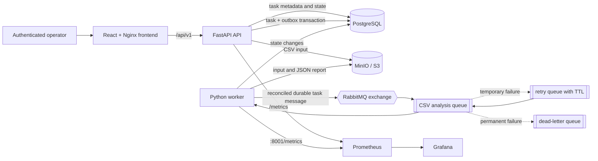

# CloudTask Architecture

## Runtime components



## Responsibilities

| Component | Responsibility |
| --- | --- |
| React frontend | Signs in the operator, collects a CSV, shows loading/errors/task state, and downloads reports with a bearer token. |
| FastAPI API | Authenticates operators, validates and stores uploads, persists owned tasks with outbox records, serves owner-scoped task/report endpoints, and exposes OpenAPI and metrics. |
| PostgreSQL | Authoritative users, task ownership/lifecycle state, timestamps, outbox records, and safe error text. It never stores CSV or report bodies. |
| RabbitMQ | Durable exchange, work queue, delayed retry queue, and dead-letter queue. |
| Worker | Claims messages, profiles CSV content, writes deterministic report objects, and changes task state. |
| MinIO | S3-compatible storage for `inputs/` and `reports/` objects. |
| Prometheus/Grafana | Collect and visualize API request and worker business/timing metrics. |

## Request-to-result flow

1. The browser logs in through `POST /api/v1/auth/login`, then sends its bearer token with multipart form data to `POST /api/v1/tasks`.
2. The API bounds the upload, validates its initial CSV header, generates a UUID, and writes the input to `inputs/<uuid>.csv`.
3. It atomically commits the owned `PENDING` task and an unpublished outbox record to PostgreSQL.
4. The worker reconciliation loop publishes a persistent `{"task_id": "...", "attempt": 0}` message from the outbox and records publication.
5. The worker receives the message with a one-message prefetch, changes the task to `PROCESSING`, and increments its attempt count.
6. The worker reads MinIO input, validates all records, calculates the profile, and writes `reports/<uuid>.json`.
7. It commits the deterministic result key and `COMPLETED` status. A second delivery sees a completed task and acknowledges it without writing another report.
8. `GET /api/v1/tasks/{id}/result` streams the report through the API; MinIO credentials stay private.

## Reliability decisions

- **Database roles:** On a fresh local volume, the PostgreSQL bootstrap administrator creates a migration role that owns the `public` schema and migration-created objects, plus an application role that can only use the schema and perform DML on those objects. The API and worker use that application role, while the migration job uses the migration role. For an existing legacy volume whose `.env` omits the dedicated-role values, Compose intentionally reuses the established PostgreSQL identity for compatibility; it does not create, reset, or transfer roles.
- **Durable messaging:** exchanges, queues, and messages are durable/persistent.
- **Retries:** retryable object-storage/database failures set the task back to `PENDING`, publish to a TTL retry queue, and return to the main queue. After `CLOUDTASK_MAX_ATTEMPTS`, the worker marks the task `FAILED` and rejects the message to the dead-letter queue.
- **Dependency readiness:** the API readiness endpoint confirms database, RabbitMQ, and S3 bucket access. S3 client retries and connect/read timeouts are bounded by `CLOUDTASK_S3_MAX_ATTEMPTS`, `CLOUDTASK_S3_CONNECT_TIMEOUT_SECONDS`, and `CLOUDTASK_S3_READ_TIMEOUT_SECONDS`.
- **Permanent CSV errors:** invalid encoding or structurally inconsistent rows become `FAILED` without retry.
- **Redelivery:** completed tasks are idempotent. Reports use task UUID keys, so a duplicate in-progress delivery overwrites the same object instead of making a new result.
- **Outbox and recovery:** PostgreSQL and RabbitMQ do not share an atomic transaction, so task creation atomically stores an outbox record. The worker retries unpublished records and returns `PROCESSING` tasks with expired local leases to `PENDING`. This is at-least-once delivery, not a distributed lease coordinator.

## Code boundaries

```text
backend/app/
├── api/             FastAPI routers and response shapes
├── application/     upload validation and task use cases
├── core/            configuration, database factory, errors, metrics
├── domain/          lifecycle enum and SQLAlchemy task model
├── infrastructure/  MinIO/S3 and RabbitMQ adapters
└── worker/          CSV profiling and queue consumer
```

The worker shares the `domain`, `core`, and `infrastructure` code with the API, but runs as a separate process and container. This keeps the project compact while preserving the operational isolation that makes asynchronous processing useful.

## Data model

Alembic creates `tasks`, `users`, and `outbox_messages`. Tasks have a nullable legacy-safe owner foreign key, lifecycle/processing fields, display metadata, generated object keys, retry state, and timestamps. New uploads always have an owner. The bootstrap job assigns pre-authentication unowned rows to the configured local operator without deleting data. The outbox has one record per task and tracks safe publication attempts.

## Local versus Kubernetes deployment

Docker Compose runs all stateful services with named persistent volumes and a one-shot migration service. The migration service waits for PostgreSQL health and must complete successfully before the API and worker start. PostgreSQL credential and ownership setup scripts run only for a new volume. Existing legacy volumes can keep their current PostgreSQL user/password through Compose's dedicated-role fallback; use the README's non-destructive procedure only to adopt the split roles or repair ownership. The Chainguard MinIO image has no `curl` binary, so Compose defers S3 availability to the API readiness check instead of running a MinIO container health command. Kubernetes manifests deploy the API, worker, frontend, services, and ingress. In Kubernetes, PostgreSQL, RabbitMQ, and MinIO are expected to be managed services or separately deployed operators/charts with persistent volumes, backups, and network policy. Apply the migration Job after secrets exist and before rolling out the deployments.
