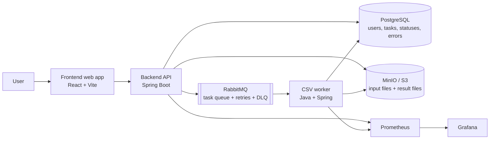

# CloudTask Architecture

## Overview

CloudTask is designed as a modular SaaS system for asynchronous CSV processing.
The initial implementation should stay simple, then evolve toward a distributed
runtime without changing the core domain model unnecessarily.

The API receives and validates user requests. File processing is delegated to a
worker so HTTP requests remain fast and predictable.

## Target Runtime Architecture



## Target Request Flow

```text
1. User uploads a CSV file.
2. API validates the file and stores it outside PostgreSQL.
3. API creates a task in PENDING status.
4. API publishes work to the processing mechanism.
5. Worker marks the task PROCESSING.
6. Worker reads the input file, generates a JSON report, and stores the result.
7. Worker marks the task COMPLETED or FAILED.
8. User polls the API and downloads the result when ready.
```

## Phase Strategy

| Phase | Goal | Main technologies |
| --- | --- | --- |
| Phase 0 | Documentation and architecture | Git, Maven skeleton, Markdown |
| Phase 1 | MVP functional | Spring Boot, PostgreSQL, local storage, local worker |
| Phase 2 | Distributed architecture | RabbitMQ, MinIO, multiple workers, retries, DLQ |
| Phase 3 | Industrialization | Docker Compose, CI/CD, security, integration tests |
| Phase 4 | Supervision and product UX | Prometheus, Grafana, React frontend |
| Later | Orchestration | Kubernetes, optional Helm/Terraform |

## Proposed Maven Architecture

Use one parent Maven project with focused modules once implementation starts:

```text
cloudtask/
├── pom.xml
├── backend/
│   ├── pom.xml
│   └── src/main/java/com/cloudtask/backend/
├── worker/
│   ├── pom.xml
│   └── src/main/java/com/cloudtask/worker/
├── frontend/
├── infra/
└── docs/
```

Recommended Java package boundaries inside backend and worker modules:

```text
com.cloudtask.<module>/
├── domain/
│   ├── model/
│   ├── value/
│   └── port/
├── application/
│   ├── command/
│   ├── query/
│   └── service/
├── infrastructure/
│   ├── persistence/
│   ├── storage/
│   ├── messaging/
│   └── migration/
└── api/
    ├── controller/
    ├── dto/
    └── error/
```

## Module Responsibilities

### Backend API

- Accept file uploads and task creation requests.
- Validate inputs.
- Persist task metadata and status.
- Expose task status and result download endpoints.
- Publish work to a processing mechanism.
- Own API errors and OpenAPI documentation.

### Worker

- Consume or receive pending work.
- Execute CSV analysis.
- Store generated JSON reports.
- Update task status and errors.
- Support retries and idempotence in the distributed phase.

### Storage

Phase 1 may use temporary local storage behind an interface. Phase 2 replaces that
implementation with MinIO/S3 without changing application use cases.

### Messaging

Phase 1 may use a local in-process dispatching mechanism behind an interface.
Phase 2 replaces that implementation with RabbitMQ queues, retries, and a dead-letter
queue.

## Key Interfaces To Introduce In Phase 1

- `FileStorage`: stores uploaded files and generated results.
- `TaskRepository`: persists and loads tasks.
- `TaskDispatcher`: delegates work to a worker mechanism.
- `CsvAnalyzer`: analyzes CSV content and creates the JSON report.
- `ResultPublisher` or `TaskResultWriter`: stores processing output.

## Architecture Decisions

| Decision | Rationale |
| --- | --- |
| Java 21 | Modern LTS runtime and required project baseline. |
| Spring Boot | Fast API development, dependency injection, validation, Actuator, OpenAPI ecosystem. |
| Maven | Simple, common build tool for Java academic and enterprise projects. |
| PostgreSQL | Reliable relational storage for task metadata, users, statuses, and errors. |
| UUID public identifiers | Avoid exposing sequential internal IDs. |
| File contents outside PostgreSQL | Heavy files belong in object storage or local storage, not relational rows. |
| RabbitMQ in Phase 2 | Adds durable asynchronous processing after the local MVP is understood. |
| MinIO in Phase 2 | Gives local S3-compatible object storage without cloud credentials. |
| Kubernetes later | Avoids infrastructure complexity before Docker Compose is stable. |

## Assumptions

- The first implementation is local and developer-focused.
- CSV analysis is the first and only MVP processing type.
- PostgreSQL is required from the MVP for realistic persistence.
- RabbitMQ and MinIO are important, but intentionally delayed to Phase 2.
- The frontend starts only after API behavior is stable.

## Risks

- Spring Boot 4.x may require dependency adjustments compared with widely used
  Spring Boot 3.x examples.
- Testcontainers requires Docker to be available locally.
- CSV parsing can become complex for large files, encodings, malformed rows, and
  separators.
- Distributed retries can create duplicate processing unless idempotence is
  designed early.
- Object storage cleanup rules must be defined to avoid orphan files.
